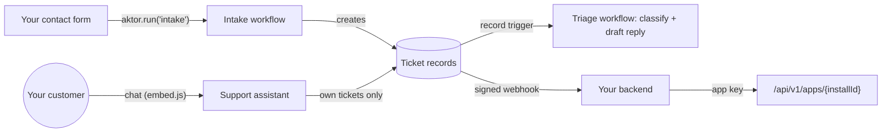

# Step by step: build a solution and put it in your app

This guide takes you from nothing to an AI-powered helpdesk running inside your own web app:
- a customer assistant on your site;
- a contact form that opens and triages tickets;
- your backend reading the results.

It follows the path the dashboard is built around, and shows the code for each step. Allow about an
hour.

The reference for everything here is [solutions.md](solutions.md); the API contract is
[api-versioning.md](api-versioning.md).

**What you'll build:**



## Contents

0. [Before you start](#0-before-you-start)
1. [Start from a template](#1-start-from-a-template)
2. [Understand what you opened](#2-understand-what-you-opened)
3. [Make it yours](#3-make-it-yours)
4. [Deploy](#4-deploy)
5. [Try it in the dashboard](#5-try-it-in-the-dashboard)
6. [Create an app key](#6-create-an-app-key)
7. [Put the assistant on your site](#7-put-the-assistant-on-your-site)
8. [Run workflows from your backend](#8-run-workflows-from-your-backend)
9. [Read and write records from your backend](#9-read-and-write-records-from-your-backend)
10. [Get told when something changes (webhooks)](#10-get-told-when-something-changes-webhooks)
11. [Go live](#11-go-live)
12. [Operate it](#12-operate-it)
13. [Troubleshooting](#13-troubleshooting)

---

## 0. Before you start

- **A running server.** `docker compose up --build` starts Postgres, the API on
  `http://localhost:5080` and the dashboard on `http://localhost:3000` (README section 7). Sign in.
  The first account owns the default organization.
- **A model.** Go to **Settings → AI model** and pick a provider with your key, or a local Ollama
  model. Without one, the built-in **Mock** model runs everything end to end with canned answers.
  That's enough to follow this guide, but the triage drafts will be placeholders.
- **The Admin role** in your organization, to deploy and create app keys. Members can build and
  test; Viewers can look.

Throughout the guide, `AKTOR_URL` is your server's API address (`http://localhost:5080` locally).

## 1. Start from a template

Open **Solutions**. A new organization lands on **Templates**:

| Template | What it is |
|---|---|
| **Helpdesk** | Tickets from your contact form and a customer assistant. An agent classifies each ticket and drafts a reply for a person to approve. A watch flags urgent tickets nobody picked up. |
| **Property management** | Maintenance requests triaged as they arrive, lease renewals started by a watch, and a resident assistant. |

Click **Use this template** on **Helpdesk**. The builder opens with a copy as a draft, saved in your
browser until you deploy. Nothing is installed yet.

> **Other ways to start:**
> - **New solution** with **Design with AI** (bottom right): describe the app in a sentence, then
>   review and apply the changes it proposes.
> - **From a terminal:** `npx aktor init my-helpdesk --template helpdesk`.

## 2. Understand what you opened

The builder's sections are the parts of every solution:

| Section | In the helpdesk | What it's for |
|---|---|---|
| **Basics** | name `helpdesk`, version `1.0.0` | Identity and version. Each upgrade raises the version. |
| **Data** | `Customer`, `Ticket` | Your data model. Agents get `data__…` tools for it, and every write is checked against these fields. A field of type `end_user` says which customer a record belongs to. |
| **Workspaces** (workflows) | `intake`, `triage` | Pipelines of stages. `intake` is a single **action** stage, with no model, that creates a ticket from its input. `triage` starts on every new ticket (a **record trigger**). It has an agent stage that classifies the ticket and drafts a reply, then an action that marks it `awaiting_review`. |
| **Assistant** | Support assistant | What your customers chat with. It can write tickets and read customers, but only that customer's own records. |
| **Inputs & connectors** | `product_name`, `support_email` | Values asked for at deploy, and integrations, whose secrets are never packaged. |
| **Knowledge & skills** | support policy, FAQ | What its agents read and follow. |
| **Evals** | "a contact-form submission opens a ticket" | Expected behaviour, checked by really running the workflow. |
| **Review & deploy** | | The `aktor.yaml` it makes, every problem found, and Deploy. |

The left-hand list shows a red count for any section with a problem. **Review & deploy** says
**✓ Valid** when the draft is ready. Until then it lists each problem with a link to its line in
`aktor.yaml`, and highlights those lines.

## 3. Make it yours

Make three changes. Together they show the main controls.

1. **Basics:** set the title to `Acme Support`.
2. **Assistant → Allowed sites:** enter the address of the site that will embed the assistant. For
   local development that's e.g. `http://localhost:3001`; add `https://app.acme.com` for
   production. While this is empty or `*` (any site, for testing) any site can use the assistant,
   and validation warns about it.
3. **Assistant → Monthly cost cap per customer:** `2`. A customer who reaches $2 of usage in a
   month gets a polite "limit reached" until the next month.

Optional:
- **A field:** in **Data**, add an `order_id` string field to `Ticket`.
- **An eval:** in **Evals**, add a case for the triage workflow.
- **With Design with AI:** ask, for example, "when a ticket is urgent, also send it to
  @connector:team_slack".

## 4. Deploy

Click **Deploy**. The dialog asks for:
- **Inputs:** your product name and support email.
- **Connector secrets**, if the solution has connectors. You can link an organization **global
  connector** instead.

It then installs everything:
- the workspaces;
- the data model and its seed records;
- the knowledge and skills;
- the assistant.

The dialog lists the **webhook URLs** it created. They contain a secret and are shown only here, so
copy any you need.

After deploying you land on the solution's **Integrate** tab. You'll come back to it in step 6.

> **CLI equivalent:** `npx aktor deploy` in the package folder (`--input product_name=Acme`).

## 5. Try it in the dashboard

Everything below works before writing any code.

- **Data tab:** open `Ticket` → **New Ticket** with subject `Charged twice`. Saving it fires the
  triage workflow, as a change from your backend would. Open the **Overview** tab → **triage** →
  **Open** to watch the run. Then reload **Data**: the ticket has a category, a priority, a draft
  reply and status `awaiting_review`.
- **Assistant tab:** issue a token for user id `ada` (a seeded customer) and turn on **Open the
  widget here**. Ask "what tickets do I have open?" You see Ada's tickets only. Try user `bob`:
  he never sees Ada's.
- **Evals tab:** **Run all**. Each case starts a real run and checks its outcome.
- **Usage tab:** the cost so far, by end user, workflow or day.

## 6. Create an app key

Your backend talks to the solution with an **app key**, not an organization API key. An app key:
- **reaches this one solution only:** its tokens, records and workflow runs;
- **is refused anywhere else:** on the organization's API, or when a web page sends it;
- **can be revoked at any time.**

So if it leaks, the exposure is one app, not your organization.

1. **Create it.** On the **Integrate** tab, under **App keys**, name it `Production backend` →
   **Create key**.
2. **Copy it.** It's shown once.
3. **Store it as server secrets.** Use your hosting provider's secrets, or `.env.local` (not
   committed):

   ```bash
   AKTOR_URL=http://localhost:5080
   AKTOR_APP_KEY=aks_…
   AKTOR_INSTALL_ID=sol-…        # shown in the Integrate tab's code
   ```

4. **Check it from your server.** The checklist's "Your backend has connected" turns green on this
   first call:

   ```bash
   curl -s $AKTOR_URL/api/v1/apps/$AKTOR_INSTALL_ID -H "Authorization: Bearer $AKTOR_APP_KEY"
   # → { "app": "Acme Support", "workflows": ["intake", "triage"], "entities": ["Customer", "Ticket"], … }
   ```

5. **Install the SDK** you'll use (optional; everything is plain HTTP underneath):

   ```bash
   npm install @aktor/sdk                    # Node, Next.js
   pip install ./sdk/python                  # Python, from the Aktor repository
   ```

The code below creates one client and reuses it.

**TypeScript** (`lib/aktor.ts`):

```ts
import { AktorServer } from "@aktor/sdk";

export const aktor = new AktorServer({
  installId: process.env.AKTOR_INSTALL_ID!,
  appKey: process.env.AKTOR_APP_KEY!,
  baseUrl: process.env.AKTOR_URL,
});
```

**Python** (`aktor_client.py`):

```python
import os
from aktor import AktorServer

aktor = AktorServer(os.environ["AKTOR_INSTALL_ID"], os.environ["AKTOR_APP_KEY"], base_url=os.environ["AKTOR_URL"])
```

`AktorServer` refuses to run in a browser, and refuses a key that isn't an app key.

## 7. Put the assistant on your site

The widget needs a short-lived **end-user token** for whoever is signed in to *your* site. Your
backend issues it with the app key. Your users never see the app key, and a token reaches only that
user's conversations and records.

### 7a. A token endpoint

The widget **POSTs** to this endpoint. It returns `{ token }` for the signed-in user, or `401`, in
which case the widget asks the visitor to sign in.

**Next.js** (App Router), `app/api/aktor-token/route.ts`:

```ts
import { aktor } from "@/lib/aktor";
import { getCurrentUser } from "@/lib/auth";   // your own sign-in

export async function POST() {
  const user = await getCurrentUser();
  if (!user) return new Response("Sign in first", { status: 401 });
  const { token } = await aktor.issueToken(user.id, { name: user.name, ttlMinutes: 60 });
  return Response.json({ token });
}
```

**Express:**

```js
app.post("/api/aktor-token", requireLogin, async (req, res) => {
  const { token } = await aktor.issueToken(req.user.id, { name: req.user.name });
  res.json({ token });
});
```

**FastAPI:**

```python
@app.post("/api/aktor-token")
def aktor_token(user=Depends(current_user)):
    return {"token": aktor.issue_token(user.id, name=user.name)["token"]}
```

**Notes:**
- **The user id is yours.** Use your own stable id for the user. Everything the token reaches
  belongs to that id. It can't contain `:`.
- **Tokens expire.** By default after 60 minutes; `ttl_minutes` sets anywhere from 5 minutes to 7
  days. The widget asks your endpoint again when one expires.
- **Already have an identity provider** (Auth0, Clerk, Cognito, Entra…)? Declare `end_users.jwt` in
  the solution ([solutions.md](solutions.md#your-own-sign-in)). Aktor then accepts your users'
  existing JWTs directly, and you don't need this endpoint.

To try all of this before touching your own product,
[samples/assistant-test-app](../samples/assistant-test-app) is a small pretend customer site (Node,
no dependencies) with sign-in, a token endpoint, the widget and a panel of the user's own records.

### 7b. The widget

Add it to the pages where signed-in customers should see it:

```html
<script src="http://localhost:5080/embed.js"
        data-install="sol-…"
        data-token-url="/api/aktor-token"
        async></script>
```

In Next.js, use `next/script` in your layout:

```tsx
import Script from "next/script";

<Script src={`${process.env.NEXT_PUBLIC_AKTOR_URL}/embed.js`} data-install="sol-…" data-token-url="/api/aktor-token" strategy="afterInteractive" />
```

The widget:
- **floats in a corner,** and follows light and dark mode;
- **runs in a shadow DOM,** so your CSS can't break it;
- **keeps the conversation** across page loads.

To put it inside your own layout instead:

```js
AktorChat.mount({ install: "sol-…", getToken: () => fetch("/api/aktor-token", { method: "POST" }).then(r => r.json()).then(j => j.token), container: document.querySelector("#help") });
```

### 7c. Or build your own chat UI

Use `AktorApp` in the browser with the end-user token, never the app key:

```ts
import { AktorApp } from "@aktor/sdk";

const { token } = await fetch("/api/aktor-token", { method: "POST" }).then((r) => r.json());
const app = new AktorApp({ installId: "sol-…", token, baseUrl: "http://localhost:5080" });

const { conversation_id } = await app.conversations.start("I was charged twice this month");
const reply = await app.conversations.waitForReply(conversation_id);
console.log(reply.messages.at(-1)?.text);
const myTickets = await app.records("Ticket");   // this user's tickets only
```

## 8. Run workflows from your backend

Any workflow can be started by your code. The helpdesk's `intake` opens a ticket from a
contact-form submission, which then triggers `triage`.

**Next.js server action** (e.g. `app/contact/actions.ts`):

```ts
"use server";
import { aktor } from "@/lib/aktor";

export async function submitContactForm(form: FormData) {
  const run = await aktor.run(
    "intake",
    { subject: String(form.get("subject")), message: String(form.get("message")) },
    { idempotencyKey: `contact-${form.get("submission_id")}` },   // a double submit opens one ticket
  );
  if (run.status !== "Completed") throw new Error(`Intake ${run.status}: ${run.summary}`);
  return { ticketOpened: true };
}
```

**Python:**

```python
run = aktor.run("intake", {"subject": "Charged twice", "message": "Please refund one."},
                idempotency_key="contact-8841")
print(run["status"], run["summary"])
for stage in run["stages"]:
    print(stage["id"], stage["status"], stage["output"])
```

**Plain HTTP:**

```bash
curl -s -X POST $AKTOR_URL/api/v1/apps/$AKTOR_INSTALL_ID/runs \
  -H "Authorization: Bearer $AKTOR_APP_KEY" -H "Content-Type: application/json" \
  -H "Idempotency-Key: contact-8841" \
  -d '{"workflow": "intake", "data": {"subject": "Charged twice", "message": "Please refund one."}}'
# → 202 { "run_id": "run-…", "status": "started" }

curl -s "$AKTOR_URL/api/v1/apps/$AKTOR_INSTALL_ID/runs/run-…?wait=30" -H "Authorization: Bearer $AKTOR_APP_KEY"
# → { "done": true, "status": "Completed", "summary": "…", "stages": [ { "id": "open-ticket", "output": { … } } ] }
```

**How runs behave:**
- **What it gets.** `input` is text and `data` is JSON; the stages read either as `input` (e.g.
  `{{ input.subject }}`).
- **Retries are safe.** The same `Idempotency-Key` returns the first run instead of starting
  another. The SDKs always send one, and retry network errors with it.
- **Waiting.** `run()` waits for the result (up to 5 minutes by default; `timeoutMs` /
  `timeout_seconds`). For long workflows, call `runs.start()` / `start_run()` and react to a
  [webhook](#10-get-told-when-something-changes-webhooks) or check later with
  `runs.get(id, { waitSeconds: 30 })`.
- **Same rules as any run.** Runs keep the workflow's budgets, safety rules and approvals. A run
  waiting for a person's approval stays `Running` until someone approves it (**Approvals** in
  the dashboard's sidebar).
- **Limits.** Each app key can start 60 runs a minute. A workflow over its `max_concurrent_runs`
  queues the run (`status: "queued"`).

## 9. Read and write records from your backend

Keep Aktor's records in step with your own data, or show them in your app:

```ts
// Open tickets, newest first
const { items, total } = await aktor.records.list("Ticket", { where: { status: "awaiting_review" }, limit: 20 });

// Comparisons: older than a day and still new
await aktor.records.list("Ticket", { filter: ["opened_at<=now-1d", "status==new"] });

// One customer's records
await aktor.records.list("Ticket", { endUser: "ada" });

// Create (an idempotency key makes retries safe), then update with optimistic concurrency
const customer = await aktor.records.create("Customer", { email: "cy@example.com", name: "Cy", account: "cy" }, { idempotencyKey: "user-cy" });
await aktor.records.update("Customer", customer.id, { plan: "team" }, { ifMatch: customer.version });
```

**Rules:**
- **Every write is checked against the data model.** A bad write answers `422` with every problem
  listed.
- **A stale `ifMatch` answers `409`.** Read the record again and retry.
- **Writes fire record triggers,** exactly as a change in the dashboard would. Creating a `Ticket`
  starts triage.

## 10. Get told when something changes (webhooks)

To react when triage finishes (for example to email a human reviewer), add a webhook to the
solution in the builder. In YAML it looks like this:

```yaml
webhooks:
  - url: "https://app.acme.com/api/aktor-events"
    events: [record.updated]
    entities: [Ticket]
```

Each change is POSTed with:
- the body `{ event, record, previous, changed_by, … }`;
- an `X-Aktor-Signature: sha256=<hex>` header, an HMAC-SHA256 of the raw body under the solution's
  **webhook secret** (shown to Admins on the **Overview** tab);
- an `Idempotency-Key` header, so you can drop redeliveries.

Always verify the signature.

**Next.js:**

```ts
// app/api/aktor-events/route.ts
import crypto from "node:crypto";

export async function POST(req: Request) {
  const body = await req.text();
  const expected = "sha256=" + crypto.createHmac("sha256", process.env.AKTOR_WEBHOOK_SECRET!).update(body).digest("hex");
  const given = req.headers.get("x-aktor-signature") ?? "";
  if (given.length !== expected.length || !crypto.timingSafeEqual(Buffer.from(given), Buffer.from(expected))) {
    return new Response("Bad signature", { status: 401 });
  }
  const change = JSON.parse(body);
  if (change.record?.status === "awaiting_review" && change.previous?.status !== "awaiting_review") {
    await notifyReviewer(change.record);   // your code; dedupe on req.headers.get("idempotency-key")
  }
  return new Response(null, { status: 204 });
}
```

**Python (FastAPI):**

```python
import hashlib, hmac, os
from fastapi import Request, HTTPException

@app.post("/api/aktor-events")
async def aktor_events(request: Request):
    body = await request.body()
    expected = "sha256=" + hmac.new(os.environ["AKTOR_WEBHOOK_SECRET"].encode(), body, hashlib.sha256).hexdigest()
    if not hmac.compare_digest(expected, request.headers.get("x-aktor-signature", "")):
        raise HTTPException(401, "Bad signature")
    change = await request.json()
    ...
```

Failed deliveries are retried with backoff, up to 8 times. Answer `2xx` quickly and do slow work in
the background.

## 11. Go live

The **Integrate** tab's checklist covers the essentials:

- [ ] **Your backend has an app key**, stored as a secret, and **has connected**.
- [ ] **Only your sites can embed the assistant:** **Assistant → Allowed sites** lists your
      production origins (https).
- [ ] **Each customer's spend is capped:** **Assistant → Monthly cost cap per customer**. Also
      check **messages per minute**.
- [ ] **Evals cover each workflow,** and pass (**Evals → Run all**, or `npx aktor test` in CI).

Also:
- **The model:** **Settings → AI model** uses a real provider, with your key.
- **Risky actions:** the workflow's safety policy asks a person to approve anything you don't want
  done automatically (sending email, refunds…). See [safety.md](safety.md).
- **Platform and model budgets:** under **Settings → Usage & billing**.

## 12. Operate it

- **Change it.** **Settings → Edit in builder** (or **Edit in builder** in the header) opens the
  installed version as a draft. Raise the version and deploy:
  - only what changed is applied;
  - runs in progress finish on the old version;
  - people's edits in a workspace survive.
- **Watch the cost.** The **Usage** tab gives the cost per end user (to bill your customers), per
  workflow and per day, with a CSV export. `npx aktor usage helpdesk --by end_user --csv` does the
  same.
- **Rotate a key.** Create a new app key, deploy it to your servers, then **Revoke** the old one.
  The **last used** time tells you when nothing uses it any more.
- **Share it.** **Settings → Publish to the registry** makes this version installable by name, in
  your organization or for everyone on the server.
- **Remove it.** **Settings → Danger zone → Uninstall** archives its workflows and keeps its records
  read-only. **Uninstall and delete records** removes them too. App keys and end-user tokens stop
  working either way.

## 13. Troubleshooting

| You see | Why | Fix |
|---|---|---|
| `401 An app key is required` | The request had no `aks_…` key, or an end-user token where the app key is needed | Send `Authorization: Bearer $AKTOR_APP_KEY` from your server |
| `401 This app key isn't valid for this solution, or it was revoked` | Wrong install id, a revoked key, or a key for another solution | Check `AKTOR_INSTALL_ID` and the key on the Integrate tab |
| `403 App keys are for your server` | The app key was sent from a browser (an `Origin` header) | Move the call to your backend; give the browser an end-user token instead |
| `403 This app can't be used from this site` | The page's origin isn't in **Allowed sites** | Add the exact origin (scheme + host + port) and redeploy; `*` allows any site while testing |
| `401` on Aktor's API (`/api/v1/solutions…`) with an app key | App keys only work on `/api/v1/apps/{installId}` | Use an organization API key for deploys and admin, the app key for your app |
| The widget says "Sign in to chat with us." | Your token endpoint answered 401/403 | The visitor isn't signed in to your site, or the endpoint isn't a `POST` handler |
| `402 You've reached this month's usage limit` | The customer hit **Monthly cost cap per customer** | Expected; raise the cap in a new version if needed |
| `429` | Too many messages for one end user, or more than 60 runs a minute for one key | Back off and retry (the SDKs do this for runs) |
| `409` on `POST /runs` | The workflow refused the run (its queue is full, or it's archived) | Read the error; wait for runs to finish |
| `409` on a record update | Someone changed it since you read it (`ifMatch`) | Read it again and retry |
| `422` on a record write | The data doesn't match the data model | The answer's `errors` lists every problem |
| A run stays `Running` | It's waiting for a person's approval | Approve it under **Approvals** in the dashboard's sidebar, or in the workspace's chat |
