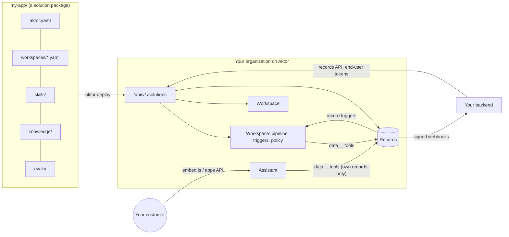

# Solutions: building your own agentic app on Aktor

A **solution** is a business application built on the platform and installed as one unit: for
example a property manager's maintenance desk, a support team's helpdesk, or a recruiting
pipeline. You write it as a folder of plain files and deploy it with the `aktor` CLI. Aktor runs
it: the agents, their data, their triggers, the assistant your own customers talk to, and the
evals that show it works.

A solution never needs changes to Aktor itself. It's assembled from the primitives the runtime
already enforces: workspaces, pipelines, triggers, connections, safety policies, budgets, skills
and knowledge. It adds three things of its own:

| Adds | What it is |
|---|---|
| **A data model** | Entities (`Lease`, `Ticket`, …) with typed fields. Agents read and write the records through tools the runtime generates and checks. |
| **End users** | Your customers talk to the solution's assistant through an embeddable widget or the apps API. Each one reaches only their own conversations and records. |
| **A lifecycle** | Install, upgrade (only what the new version changed), uninstall, evals, version history. |



What changed to build all this, release by release, is in [solutions-changelog.md](solutions-changelog.md).

The complete example is [samples/solutions/property-mgmt](../samples/solutions/property-mgmt). It
triages maintenance requests as they arrive, starts lease renewals with a compiled watch, and gives
residents an assistant that logs requests and answers lease questions.

## The builder: no CLI or YAML needed

**Solutions → New solution** in the dashboard opens the **builder**. It has forms for everything a
package holds:
- basics and version;
- the data model (entities, fields, types, indexes);
- workspaces (agent and action stages, "runs after", record, schedule and webhook triggers, data
  access, autonomy);
- the assistant and your own sign-in;
- inputs and connectors, picked from the server's plugins;
- knowledge and skills;
- evals.

It checks the solution against the server as you type, and shows each problem in its section.
**Deploy** installs it (or upgrades it, when that name is installed) straight from the page. It asks
for inputs and secrets, then shows the webhook URLs it created. There's nothing to download first.

The builder writes the same package the CLI reads:
- **Review & deploy** shows the `aktor.yaml` it makes. **Package (.zip)** downloads the whole package
  (the manifest and its skill files) for git or the CLI.
- **Edit YAML** lets you change the text and apply it back to the forms.
- **Edit in builder** on an installed solution opens that version. **Open a folder** loads a package
  from disk.
- Drafts are saved in your browser until you deploy or discard them.

The CLI is an alternative for people who prefer the terminal. Neither is required for the other.

### Designing in a conversation

**Design with AI**, at the bottom right of the builder, opens a chat about the solution. You
describe it in plain language: the whole app ("a helpdesk where customers report issues, an agent
triages them by urgency, and an assistant answers status questions") or one change ("add a Vendor
entity with name, phone and hourly rate", "add an eval for each workspace", "send a Slack message
when an urgent request comes in"). It can change every section: basics, inputs, connectors, the
data model, workspaces with their pipelines and triggers, skills, knowledge, the assistant, seed
data, webhooks and evals.

- **You review every change.** Each answer lists the changes it would make, already checked
  against the server, with any problems they'd leave to fix. Nothing changes until you press
  **Apply**, and an applied change can be undone from the conversation.
- **The forms stay the source of truth.** The designer always works on the draft as it is now,
  including your own edits. If the draft changed since a proposal was made, applying it asks first.
- **It knows what's available.** That covers the server's plugins and your organization's global
  connectors (it prefers those for a connector), and the platform's capabilities.
- **It asks when it must.** When a request needs a decision only you can make, it asks instead of
  guessing, and proposes nothing.
- It runs on your organization's model and is billed like any model call. The conversation is kept
  in your browser with the draft. With the Mock model it handles only a few phrasings (add or remove
  an entity, rename, add an eval).

The API is `POST /api/v1/solutions/design` with `{manifest, skills, history, request}` (Member). It
returns `{reply, summary, changes, errors, manifest, skills, problems, warnings, can_apply}` and
saves nothing.

### Mentions

Type `@` in the builder to refer to the solution's own parts and your organization's. That works
in the **Design with AI** chat and in the text boxes agents read: a workspace's goal, its stages'
instructions, its triggers' instructions, the assistant's instructions, skills' instructions and
eval inputs. Each box suggests only what its agents can actually use:

| Mention | Example | In the builder |
|---|---|---|
| An agent (a stage), by its id | `@triage` | A workspace's own stages. In the chat, any stage, plus `@assistant` |
| A workspace | `@workspace:requests` | The chat only |
| A skill | `@skill:handling-requests` | The solution's skills for that workspace, then the organization's |
| Knowledge | `@knowledge:refund-policy` | The solution's knowledge for that workspace, then the organization's |
| A connector | `@connector:sms` | The solution's connectors. In the chat, the organization's global connectors too |

- **What agents do with a mention:** the same as anywhere else ([workspaces.md](workspaces.md#mentions)).
  A named skill is loaded first and named knowledge is read first. A named connector's tools
  (`sms__send`, …) are pointed out; when the agent has none of them, it says so instead of working
  around it.
- **Mentioning a connector connects it.** A declared connector mentioned in a workspace's text, or
  in the assistant's instructions, is added to that workspace's (or the assistant's) connectors.
- **The assistant doesn't get the solution's skills or knowledge.** Those are installed into the
  workspaces, so the assistant's box offers only the organization's.
- **In the chat, the designer is told what each mention is.** For example, "post to
  `@connector:team_slack` when `@triage` marks a request urgent" names that stage and that global
  connector exactly. The designer also writes mentions into the instructions it proposes.
- **Renames follow.** Renaming a skill, a connector, a knowledge entry or a stage id rewrites the
  mentions of it. A connector's rename also updates the workspaces and the assistant that use it.
- **Validation warns** when a workspace or the assistant mentions:
  - a skill or knowledge that isn't in the package (fine if your organization has it);
  - a connector that isn't declared;
  - a connector the workspace doesn't use.

## Quick start

```bash
cd sdk/typescript && npm link        # or: npx aktor …   (Node 18+)
export AKTOR_URL=http://localhost:5080 AKTOR_API_KEY=ak_...   # an Admin key: Settings → API keys

aktor init my-app && cd my-app       # scaffold a working package
aktor validate                       # check it against the server; nothing is installed
aktor deploy                         # install it (or upgrade the installed version)
aktor dev                            # redeploy on every change while you work
aktor test                           # run its evals for real; exit code 1 if any fail
aktor records my-app Request         # look at its data
aktor token my-app customer-42       # a token for one of your end users
aktor usage my-app --csv             # what it cost, per end user
aktor publish --public               # share this version through the registry
aktor install other-app@1.0.0        # install someone's published package
```

The same guide is in the dashboard at **/docs**, along with the rest of the platform.

The dashboard has a **Solutions** page that shows what's installed (workspaces, records, the
assistant, usage, evals and history). It can also deploy a package folder you pick in the browser,
or build a solution with no files at all (see the builder above).

## The package

```
my-app/
  aktor.yaml                 the manifest (YAML or JSON)
  workspaces/requests.yaml   a workspace in its own file (optional: they can be inline)
  skills/<name>/SKILL.md     skills, in the Agent Skills format
  knowledge/*.md             reference text agents search
  assistant.md               the assistant's instructions (instructions_file)
  evals/*.yaml               eval cases
```

The CLI sends the manifest and every text file (`.yaml .yml .json .md .txt .csv .py .js .html .sql`)
except hidden folders, `node_modules`, `bin` and `obj`. The server parses everything, so the CLI
needs no YAML library. Packages are at most 5 MB and 300 files.

### aktor.yaml

```yaml
format: 1
name: property-mgmt            # stable id in your organization (lowercase, digits, dashes)
title: Property management
version: 1.2.0                 # semantic version; an upgrade must raise it (or use --force)
requires_platform: ">=1.2.0"   # optional: the platform versions it works on (>=, >, =, ^ or a bare version meaning ^)
description: Triages maintenance requests and starts lease renewals.

inputs:                        # asked for at install; workspaces see them as {{ vars.key }}
  - { key: company_name, label: Company name, default: Acme Properties }
  - { key: late_fee_percent, type: number, default: "5" }          # string | text | number | integer | boolean

connectors:                    # integrations it needs; secrets are asked for at install, never packaged
  - name: sms
    plugin: twilio-sms
    settings: { from_number: "{{ inputs.sms_from }}" }
    required: true             # false: installs without it
  - name: crm
    plugin: http-api
    global: team_crm           # optional: use the organization's global connector instead of asking for secrets

entities: { … }                # the data model (below)
workspaces: [ … ]              # below
skills:    [ { path: skills/maintenance-triage/SKILL.md, workspace: maintenance-desk } ]   # workspace optional
knowledge: [ { key: Maintenance policy, path: knowledge/maintenance-policy.md } ]          # or text: …
assistant: { … }               # below (optional)
seed: { … }                    # records created at first install only (below)
webhooks:  [ … ]               # your backend, told about record changes (below)
evals:     [ … ]               # below
```

`requires_platform` is checked against the server's solution platform version (1.3.0 here; see
[api-versioning.md](api-versioning.md)). A server that's too old refuses the package with the
reason, instead of installing something that half works. Minor versions only add features, so
`>=1.2.0` (or `^1.2.0`) is the usual choice.

`{{ inputs.key }}` is filled in where the runtime reads values: connector settings, webhook URLs,
and the assistant's instructions and greeting. Inside workspaces, inputs are workspace
[variables](workspaces.md#variables), so stages use `{{ vars.key }}`.

### Workspaces

Each entry is a workspace, written the same way you'd configure one by hand. A pipeline uses the
[pipeline](workspaces.md) and [workflow](workflows.md) fields in snake_case. An entry may live in
its own file: `- file: workspaces/maintenance-desk.yaml`.

```yaml
key: maintenance-desk          # stable across versions: upgrades match workspaces by it
name: Maintenance desk
goal: Triage every new maintenance request.
data: { Ticket: write, Lease: read, Property: read }   # its records access (below)
connectors: [sms]              # which of the solution's connectors it gets
daily_cost_usd: 5              # daily_tokens too
safety:                        # the workspace safety policy (docs/safety.md)
  autonomy: SemiAutonomous
  rules: [{ tool_pattern: "sms__*", applies: Writes, decision: RequireApproval }]
variables: { escalation_email: ops@example.com }
pipeline:
  max_concurrent_runs: 3
  stages:
    - stage_id: triage
      name: Triage
      role: Maintenance coordinator
      instructions_file: prompts/triage.md          # or instructions: …
      capabilities: [research]
    - stage_id: notify
      name: Tell the resident
      kind: Action                                   # no model: one tool call
      inputs: [triage]
      tool: sms__send
      arguments: { to: "{{ input.record.phone }}", text: "We got your request." }   # an object or a JSON string
triggers:
  - kind: Record               # a record change starts a run (below)
    name: New ticket
    entity: Ticket
    on: [created]
  - kind: Schedule
    name: Weekly digest
    cron: "0 8 * * 1"
    instruction: Summarise last week's tickets.
```

Webhook, form and watch triggers work as in [workspaces.md](workspaces.md). A watch's
`source_arguments` can be written as an object.

### Using global connectors

A connector can use one of the organization's [global connectors](plugins.md#global-connectors)
instead of asking for its secrets at every install. The deployer doesn't type the keys again, and
rotating them on the Connectors page reaches the solution.

- **At deploy.** For each connector, the deploy dialog lists the organization's global connectors
  of the same plugin. When exactly one fits, a new install uses it by default. Over the API, pass
  `globals: { crm: "team_crm" }` (connector name → global connector name or id). `""` goes back to
  the connector's own secrets.
- **In the package.** `global: team_crm` names one. Names differ between organizations, so for a
  package you share, choosing at deploy is usually better.
- **Upgrades keep the choice** unless the deploy changes it. Moving a connector onto a global
  connector, or off one, relinks the workspaces' connections.
- **What uses it.** The solution's workspaces link it, and so do its assistant's conversations. The
  plugin must match, and the connector must be in the deploying organization.
- `validate` returns `globals`: for each connector, the global connectors that could back it.

## Data: entities and records

```yaml
entities:
  Lease:
    description: A resident's lease of a unit
    title_field: unit
    fields:
      property:      { type: ref, entity: Property, required: true }
      unit:          { type: string, required: true }
      resident:      { type: end_user }
      rent:          { type: number, required: true }
      ends_on:       { type: date, required: true }
      status:        { type: enum, values: [active, renewing, ended], default: active }
```

| Type | Stored as | Notes |
|---|---|---|
| `string` | text (2,000 chars) | |
| `text` | text (50,000 chars) | |
| `integer`, `number` | number | "3" and 3.0 are accepted and normalized |
| `boolean` | true / false | "yes"/"no" accepted |
| `date` | `YYYY-MM-DD` | |
| `datetime` | ISO 8601, UTC | |
| `enum` | one of `values` | matched case-insensitively, stored as declared |
| `ref` | a record id of `entity` | must exist, and be visible to the writer |
| `end_user` | an end user's id | **set by the runtime**, never by the writer (below) |
| `json` | any JSON (50,000 chars) | |

Add `indexed: true` to a field you filter or sort large tables by: the runtime creates a database
index on it when the solution is installed (concurrently, so writes carry on), drops it when a
version stops asking for it, and rebuilds it if the field's type changes. Up to 20 indexed fields
per solution; `text` and `json` fields can't be indexed.

Every write goes through the same checks, whoever writes: an agent's tool call, an action stage,
your backend, or a seed. Unknown fields are refused, types are checked and normalized, required
fields must be present, enum values must be allowed, and refs must point at a record the writer
can see. A record also gets `id`, `version`, `created_at` and `updated_at`. A record that others
refer to can't be deleted.

Records live in Postgres (JSONB). Every filter and sort runs in SQL over the whole table. Exact
matches (`where`) use the GIN index on the data. Numbers compare as numbers; other fields compare as
text in byte order, so ISO dates sort correctly. Equality and `contains` ignore case. Every query is scoped by organization and install, plus end user
where that applies, so another organization's records can't be reached by any path.

### What agents get

Each workspace with a `data:` section gets a connection named **`data`**. Its tools depend on the
access you gave each entity:

| Tool | Access | Side effects |
|---|---|---|
| `data__describe_data` | any | read-only |
| `data__list_<entity>` | read | read-only: `where` (exact), `filters` (`<`, `<=`, `>`, `>=`, `==`, `!=`, `contains`, `exists`), `order_by`, `limit`, `offset` |
| `data__get_<entity>` | read | read-only |
| `data__create_<entity>` | write | idempotent: the record id comes from the call's idempotency key, so a replay after a crash finds the record it made |
| `data__update_<entity>` | write | idempotent; `expected_version` refuses a stale write |
| `data__delete_<entity>` | write | idempotent |

`WorkOrder` becomes `work_order` in tool names. Because `data` is an ordinary connection, its tools
go through the workspace's safety policy and approvals. For example, `tool_pattern: "data__delete_*"`
with `RequireApproval` makes every delete wait for a person. They're also in the audit log, and
watches and action stages can use them. Filters accept **relative dates**: `today`, `today+30d`,
`today-1w`, `now+2h`.

The connection carries a **signed binding** naming the organization, install, entities and (in
an end user's conversation) the end user. Editing the connection's settings can't point it
anywhere else.

### Record triggers

A `Record` trigger starts a run of its workspace's pipeline for each matching change:

```yaml
- kind: Record
  name: Urgent tickets
  entity: Ticket
  on: [created, updated]                 # default: [created]
  rule:                                  # optional: conditions on the record (the watch rule syntax)
    conditions: [{ field: priority, op: "==", value: urgent }]
  instruction: Page the on-call technician.
```

The run's input data is `{ entity, event, record_id, record, previous }`, so action stages can use
`{{ input.record_id }}` and `{{ input.record.priority }}`. Changes are written to an outbox in the
same transaction as the record. A dispatcher delivers them to the solution's workspaces, which fire
each matching trigger **once per change**, whatever happens in between. Seed records don't fire
triggers, and a change made by one of a workspace's own runs doesn't start another run of that
workspace, so a trigger can't feed itself. Other workspaces' triggers still see the change.

For time-based rules ("leases ending within 60 days"), use a compiled **watch** on
`data__list_<entity>`. It runs without the LLM until something matches (see the sample's
`lease-renewals.yaml`).

### Seed data

```yaml
seed:
  Property:
    - { id: p-elm, name: Elm Court, address: "12 Elm Street" }
  Lease:
    - { property: p-elm, unit: "4B", resident: demo-resident, rent: 1450, ends_on: "2026-12-31" }
```

Seed records are created at first install only, and validated like any write. An `id` is a name
for referring to the record within the seed: it becomes a real record id, and refs that use it
follow.

### Your backend

```http
GET    /api/v1/solutions/{id|name}/records/{Entity}?where.status=open&filter=ends_on<=today+30d&order_by=ends_on&desc=false&limit=50
GET    /api/v1/solutions/{id|name}/records/{Entity}/{recordId}
POST   /api/v1/solutions/{id|name}/records/{Entity}          body: fields   (Idempotency-Key: … makes retries safe)
PATCH  /api/v1/solutions/{id|name}/records/{Entity}/{recordId}   body: changed fields, null clears   (If-Match: "<version>")
DELETE /api/v1/solutions/{id|name}/records/{Entity}/{recordId}
```

After an uninstall without `purge`, records stay readable but writes are refused (`409`), since
nothing would react to them. The dashboard's **Data** tab lists records, and Members can create,
edit and delete them there. Edits send the version they read, so a change made in between is
refused instead of overwritten.

Filters: `field<=value`, `>=`, `<`, `>`, `==` (or `=`), `!=`, `field~text` (contains), `field?`
(exists). Add `end_user=<id>` to list one end user's records. Writes need a Member key, reads a
Viewer key. Invalid data is refused with every problem listed (`422`), a stale `If-Match` with
`409`.

### Webhooks to your backend

```yaml
webhooks:
  - url: "{{ inputs.backend_url }}/aktor/events"
    events: [record.created, record.updated]     # or record.* (default)
    entities: [Ticket]                           # default: all
```

Each change is POSTed as `{ event, change_id, solution, install_id, entity, record_id, record, previous, changed_by, at }`
with these headers:
- `X-Aktor-Event`
- `Idempotency-Key: record-change-<install>-<change_id>`, for dropping redeliveries
- `X-Aktor-Signature: sha256=<hex HMAC-SHA256 of the body>`, signed with the solution's
  **webhook secret** (returned at install and shown to Admins with the install)

Failed deliveries are retried with backoff, up to 8 times.

### Finding a webhook trigger's URL

A workspace's own **webhook triggers** (the helpdesk's contact form, for example) have a secret
URL. Because the secret is in it, the URL is shown only in these places, never in the triggers
list or its API:
- the CLI's install output;
- the deploy dialog after installing or upgrading from the dashboard;
- the workspace's chat ("Webhook '…' created … POST /api/hooks/…").

An upgrade keeps the same URL. URLs on private networks need
`Tasks:Callbacks:AllowPrivateNetworks`.

## End users

Your customers aren't members of your organization. Your backend signs them in however it already
does, then asks Aktor for a short-lived **end-user token**:

```http
POST /api/v1/solutions/{id|name}/end-user-tokens        (Admin API key)
{ "user_id": "resident-4b", "name": "Sam", "ttl_minutes": 60 }
→ { "token": "aeu_…", "expires_at": "…" }
```

The token names the install and the user, is signed by the server, and expires (7 days at most,
`Solutions:MaxEndUserTokenLifetime`). It works on the **apps API** only. To everything else it's
an anonymous request.

### Your own sign-in

Instead of exchanging every login for an Aktor token, a solution can accept **your identity
provider's tokens** (JWTs) on the apps API directly:

```yaml
inputs:
  - { key: auth_domain, default: auth.example.com }
end_users:
  jwt:
    issuer: "https://{{ inputs.auth_domain }}/"
    audience: my-app
    jwks_url: "https://{{ inputs.auth_domain }}/.well-known/jwks.json"
    user_claim: sub          # your id for the user (default)
    name_claim: name         # optional
```

Aktor checks the signature against the keys the provider publishes, plus the issuer, the audience,
`exp` and `nbf` (with a minute of clock skew). It accepts RS256/384/512, PS256/384/512 and
ES256/384/512. It refuses `none` and shared-secret (HS) tokens, because anyone holding the secret
could sign in as anyone. Keys are cached for ten minutes and fetched again (at most once a minute)
when a token names a new key, so key rotation needs no restart. The embed widget's
`data-token-url` can simply return your own token. `jwks_url` must be https (http only on
localhost, for development).

### The assistant

```yaml
assistant:
  name: Resident helper
  greeting: Hi! I can log a maintenance request or answer questions about your lease.
  instructions_file: assistant.md
  data: { Lease: read, Ticket: write, Property: read }
  connectors: []                 # solution connectors it may use (secrets are copied inside the server)
  max_tokens: 30000              # per message round
  max_cost_usd: 0.25
  max_conversations_per_day: 20  # per end user
  max_messages_per_minute: 10    # per end user, counted once for the whole cluster
  allowed_origins: ["https://app.example.com"]   # sites whose pages may call it; empty: any
  monthly_cost_limit_usd_per_user: 2.00          # optional cap per end user per calendar month
```

Rate limits are counted per end user across every server, by one grain per user. With
`allowed_origins`, a request from a page on any other site gets `403`. Requests without an
`Origin` header, such as your backend calling the apps API, aren't affected. Secrets for the
assistant's `connectors` are asked for at install and kept in the vault for the assistant, so a
connector only the assistant uses works too.

Each conversation is a task the end user owns. Its root agent gets the assistant's instructions and
a records connection **bound to that end user**. For entities with an `end_user` field, it can list,
read, change and link only that user's records. Records it creates are theirs, whatever the model
puts in the field. Entities without an `end_user` field (`Property` above) are shared reference data
at the access you gave. The assistant can't spawn helpers. The user's messages are untrusted input
and can't change its instructions, tools or limits. You see every conversation in the dashboard as
an ordinary task of your organization.

### The embed widget

```html
<script src="https://YOUR-AKTOR/embed.js"
        data-install="sol-…"
        data-token-url="/api/aktor-token"
        async></script>
```

`data-token-url` points at your backend, which returns `{ "token": "aeu_…" }` for the signed-in user.
The widget calls it again when a token expires. The widget runs in a shadow DOM, so your page's CSS
can't break it. It follows the visitor's light or dark preference and keeps the current
conversation across page loads. For more control, call it yourself:

```js
const chat = AktorChat.mount({ install: "sol-…", getToken: () => myBackend.aktorToken(), container: document.querySelector("#help") });
```

Use `data-token="aeu_…"` instead of a token URL for demos.

### The apps API

What the widget uses, for building your own UI (CORS is open to any origin; the token is the credential):

```http
GET  /api/v1/apps/{installId}                                 the app, the assistant, the user
GET  /api/v1/apps/{installId}/conversations                   the user's conversations
POST /api/v1/apps/{installId}/conversations                   { "message": "…" } → { conversation_id }
GET  /api/v1/apps/{installId}/conversations/{id}              { messages: [{ role, text, at }], answering }
POST /api/v1/apps/{installId}/conversations/{id}/messages     { "message": "…" }   (409 while still answering)
GET  /api/v1/apps/{installId}/records/{Entity}                the user's own records (entities with an end_user field)
```

The SDKs wrap it: `AktorApp` in [TypeScript](../sdk/typescript) and [Python](../sdk/python).

## Usage and billing

A solution's cost comes from the runtime's own metering: every agent's tokens and dollars, the
same numbers your plan is metered by. It's broken down the way you bill:

```http
GET /api/v1/solutions/{id|name}/usage?by=end_user&from=2026-10-01&to=2026-11-01
GET /api/v1/solutions/{id|name}/usage?by=day&format=csv
```

`by` is `end_user` (the default), `workspace` or `day`, and the period defaults to this calendar
month (400 days at most). Each line has conversations, runs, tokens and `cost_usd`. An end user is
charged for their own conversations; workspace runs belong to no one end user (group by
`workspace` to see them). Pass the cost on with your own markup.

To cap an end user, set `assistant.monthly_cost_limit_usd_per_user`. Once their conversations this
month reach it, starting or continuing one answers `402` until the next month, or until a new
version raises the cap. The dashboard's **Usage** tab shows the same report, with a CSV export.
`aktor usage <name> --by end_user --csv` does too.

## The registry

Solutions travel between organizations through the **registry** on your server:

```bash
aktor publish                   # this folder's version, for your organization only
aktor publish --public          # or for every organization on the server
aktor search helpdesk           # the latest version of each package you can see
aktor install helpdesk          # install the latest; or helpdesk@1.0.0; run again to upgrade
aktor yank helpdesk 1.0.1 --reason "broken migration"   # --undo to restore
```

- A package **name belongs to the organization that first published it**. Nobody else can publish
  versions of it.
- **Versions are immutable** and must go up. A bad version is **yanked**: "latest" skips it, an exact
  version still resolves, and existing installs keep working.
- **Integrity:** each version is stored with its SHA-256 and the registry's signature over name,
  version and digest (an HMAC under a key derived from the server's master key). Installing checks
  both, so a package altered after it was published is refused.
- Installing from the registry (`POST /api/v1/solutions { "package": "helpdesk@1.0.0" }`, or
  `PUT` to upgrade) goes through the same validation, inputs and secrets as a folder, and counts
  the install.

In the dashboard, **Solutions** lists the registry with *Install* (or *Upgrade*) buttons, and an
installed solution's page has *Publish to registry*.

| Method | Path | Role |
|---|---|---|
| `POST` | `/api/v1/registry/packages` | Admin: `{ bundle, visibility: "organization" \| "public" }` |
| `GET` | `/api/v1/registry/packages?q=` | Viewer: the latest version of each visible package |
| `GET` | `/api/v1/registry/packages/{name}` | Viewer: every version |
| `GET` | `/api/v1/registry/packages/{name}/{version\|latest}` | Viewer: the package, integrity-checked |
| `POST` | `/api/v1/registry/packages/{name}/{version}/yank` | Admin (publisher): `{ yank, reason }` |
| `POST` | `/api/v1/solutions/{id\|name}/publish` | Admin: publish the installed version |

## Upgrades

`aktor deploy` on an installed solution upgrades it. The new version must be higher (`--force`
redeploys the same or an older one, which `aktor dev` does on every save). `--dry-run` reports what
would change without changing anything. An upgrade applies **only what the package changed**, so
edits people made in a workspace since the last deploy survive an upgrade that didn't touch them:

| What | On upgrade |
|---|---|
| Workspaces | New keys are created; removed keys are archived; others are updated in place (their runs, chat and history stay). |
| Pipeline | A new pipeline version if the package's pipeline changed. Runs in progress finish on the version they started with. |
| Safety policy, daily budget | Applied if the package changed them. |
| Variables | The package's own (inputs and declared variables) are replaced; ones added in the workspace stay. |
| Triggers | Matched by name: changed ones are replaced, new ones added, the package's removed ones removed. A webhook is updated in place, so it keeps its URL (and the secret in it) and the service posting to it keeps working. Triggers people added by hand stay. |
| Records connection | Re-bound if a workspace's data access changed; its tools are re-listed either way (fields may have changed). |
| Connectors | New ones are added (pass their secrets once); ones removed from a workspace are removed. |
| Skills, knowledge | Updated to the package's; ones the package no longer has are removed. |
| Records | Kept as they are. Field changes apply to the next write; the upgrade reports new required fields, type changes and removed fields or entities. |
| Inputs | Previous values are kept unless you pass new ones. |

Every install, upgrade and redeploy is in the install's **history**.

## Evals

```yaml
# evals/triage-urgent-leak.yaml (listed under evals: in aktor.yaml as - file: …)
name: urgent leak is triaged
workspace: maintenance-desk
input: "Ticket created: water is pouring through the ceiling of unit 4B."
input_data: { record: { issue: "Water is pouring through the ceiling" } }   # optional, for action/script stages
timeout_seconds: 300
expect:
  status: Completed                     # the run's final status (default)
  summary_contains: [urgent]
  summary_not_contains: [error]
  records:                              # records the run's agents created or changed
    Ticket: { at_least: 1, where: { priority: urgent } }
```

`aktor test` (or `POST /api/v1/solutions/{id}/evals`) runs each case for real. It starts a run with
the input, waits for it, and checks the expectations. It exits with 1 if any fail, so it fits CI.
Evals spend like any run. With the Mock model they check the plumbing; with a real model they check
behaviour.

## API

| Method | Path | Role |
|---|---|---|
| `POST` | `/api/v1/solutions/validate` | Member: `{ manifest, files }` → `{ ok, errors, warnings, summary, secrets }` |
| `POST` | `/api/v1/solutions/parse` | Member: `{ manifest, files }` → the manifest as structured JSON (what the builder edits) |
| `GET` | `/api/v1/solutions/{id\|name}/package` | Viewer: the package an install was deployed from (no secrets) |
| `POST` | `/api/v1/solutions` | Admin: `{ bundle, inputs, secrets }` → the install, its workspaces, webhook URLs and secret |
| `GET` | `/api/v1/solutions` | Viewer: installs (`?all=true` includes uninstalled ones) |
| `GET` | `/api/v1/solutions/{id\|name}` | Viewer: one install: workspaces, entities with counts, assistant, evals, history |
| `PUT` | `/api/v1/solutions/{id\|name}` | Admin: upgrade: `{ bundle, inputs, secrets, force, dry_run }` |
| `DELETE` | `/api/v1/solutions/{id\|name}?purge=true` | Admin: uninstall (workspaces archived; `purge` deletes records) |
| `POST` | `/api/v1/solutions/{id\|name}/evals` | Member: `{ names? }` → results |
| `POST` | `/api/v1/solutions/{id\|name}/end-user-tokens` | Admin: `{ user_id, name?, ttl_minutes? }` |
| `GET` | `/api/v1/solutions/{id\|name}/usage` | Viewer: cost by end user, workspace or day (`?format=csv`) |
| `POST` | `/api/v1/solutions` with `{ "package": "name@version" }` | Admin: install from the registry (also `PUT` to upgrade) |
| | `/api/v1/solutions/{id\|name}/records/...` | the records API (above) |
| | `/api/v1/apps/{installId}/...` | the apps API, with an end-user token (above) |

`/api/v1/...` is the versioned contract ([api-versioning.md](api-versioning.md)).

## Security model

- **The runtime decides, not the package or the model.** A manifest declares what a solution
  needs. Installing it goes through the same checks as doing it by hand: Admin role, plan quotas,
  pipeline validation, safety policies and the audit log. A package can't grant itself more than an
  Admin could configure.
- **Isolation.** Records, installs and conversations carry the organization's id, and every query
  filters by it. The API answers 404 across organizations. Records connections are signed bindings
  (HMAC under keys derived from the secrets master key, one key per purpose), so a connection can't
  be edited to reach other records.
- **Federated sign-in** only accepts asymmetric signatures checked against the provider's published
  keys, for the declared issuer and audience.
- **Registry packages** are verified against their digest and the registry's signature at every install.
- **End users** hold signed, expiring tokens that work on the apps API only. Their conversations'
  tools are bound to them, so a prompt can't reach another user's data: the runtime filters it
  before the model sees anything. Rate limits and per-message budgets bound what one user can spend.
- **Secrets** are never in a package or a manifest. They're passed at install, stored encrypted in
  the vault, and never shown to agents.
- **Webhooks** are signed, and refused on private networks unless allowed.

## Limits

20 workspaces, 40 entities, 60 fields per entity, 50 inputs and 1,000 seed records per solution; a
200 KB record; a 5 MB package; 200 records per page. Exact matches are indexed. Comparison filters
and sorting on a field run in SQL but aren't indexed per field, so for very large tables, narrow
with `where` first, or keep the data in your own database and reach it through a connector.

## Tests

- `SolutionTests` (unit): reading and validating packages (the sample package included), record
  validation and normalization, the end-user field, relative dates, record triggers, signed bindings
  and end-user tokens.
- `RemotePluginTests` (unit): the remote-plugin protocol.
- `EndUserJwtTests` (unit): federated tokens:
  - valid RS and ES tokens;
  - refused audience, issuer, expiry, `none`, HS, tampered and foreign-key tokens;
  - picking up a rotated key.
- The builder was checked end to end in a browser:
  - both samples open in it and validate;
  - a new solution deploys from the page;
  - its downloaded `.zip` passes `aktor validate`.
- `SolutionPlatformApiTests` (integration):
  - publishing, visibility, immutability and name ownership;
  - installing and upgrading by name, yanking, and refusing a tampered package;
  - per-field indexes created, used by the query planner, and dropped;
  - usage per end user, the CSV export and the monthly cap;
  - end users signing in with a builder's JWT against a live JWKS endpoint.
- `SolutionsApiTests` (integration, real API and Postgres) also cover:
  - both samples running end to end (the helpdesk's webhook, action stage, record trigger and eval);
  - filters and sorting in SQL;
  - a webhook keeping its URL across an upgrade;
  - read-only records after uninstall;
  - allowed origins and cluster-wide rate limits;
  - assistant-only connector secrets;
  - a trigger not feeding itself.

  And, from before:
  - the sample installing with its workspaces, tools, watch, seed and know-how;
  - records firing record triggers and signed webhooks;
  - idempotent creates and optimistic concurrency;
  - evals passing and failing;
  - upgrades: refused without a version bump, dry runs, archived workspaces, replaced triggers;
  - uninstall with purge;
  - end users seeing only their own conversations and records, including through the records tools;
  - tenant isolation.
