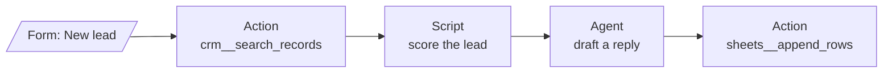

# Workflows: actions, scripts, forms and connectors

A workspace's pipeline ([workspaces.md](workspaces.md)) is a graph of stages. Most stages are AI
agents. Two other kinds are fixed steps with no model involved, which is how tools like n8n work:

| Stage | What does the work | Costs a model call? |
|---|---|---|
| **Agent** | An AI agent with a role, instructions and tools. | Yes |
| **Action** | One call of a connection's tool (Google Sheets, Airtable, BigQuery, Zoho CRM, any REST API, an MCP server), with arguments built from the run's data. It can call the tool once per item of a list. | No |
| **Script** | Python or JavaScript that turns the run's data into new data, in a sandbox with no network. | No |

You can mix them freely. For example, a **form** collects a lead, an **action** looks the company up
in the CRM, a **script** scores it, an **agent** writes a tailored reply, and a last **action**
appends the result to a Google Sheet.



## Data between stages

Every stage produces an **output**, which is JSON:

- an action: the tool's result (a list of results with *for each*);
- a script: whatever it returns;
- an agent: `{ "status", "summary", "artifacts", "remaining_work" }`.

Action and script stages see the run's data as one object:

| Name | What it is |
|---|---|
| `input` | The run's input: a form's answers (`input.email`), a webhook's JSON body, a watch's `input.matches`, the `data` given to `POST /runs`; otherwise the text typed. |
| `stages.<id>` | The output of any stage that has finished, e.g. `stages.read-sheet.rows`. |
| `previous` | The output of the stage's only input (null when it has several). |
| `item`, `index` | In an action's *for each*: the current item and its position. |
| `run` | `id`, `number`, `source`, `trigger`, `started_at`. |

Agent stages read earlier results as text: an action's or script's output is handed to them as
`Output (JSON): …`.

## Action stages

An action names a connection tool (`<connection>__<tool>`, as agents see it) and its **arguments**:
a JSON object in which any string may contain `{{ expressions }}`.

```json
{
  "range": "Leads",
  "rows": "{{ previous }}",
  "note": "Added by run {{ run.number }} for {{ input.email }}"
}
```

- A string that is **only** an expression becomes that value with its type: `"{{ previous }}"` is
  the list itself, `"{{ input.seats }}"` a number.
- Expressions inside longer text are written in as text.
- Paths use the same JSONPath subset as watches: `.name`, `['Full name']`, `[0]`, `[*]`
  (`stages.read-sheet.rows[*].Email` is the list of emails). Something missing is null (empty in text).

**For each** names a list (e.g. `previous.rows` or `input.contacts`). The tool is called once per item,
up to `Pipelines:MaxForEachItems` (100), and the output is the list of results.

Actions follow the rules agents follow:

- **Safety policies.** The organization's and the workspace's policies apply. A tool that a rule denies
  fails the stage. A tool that needs a person's approval also fails it, because an action can't wait
  for one; use an agent stage for that step instead.
- **Audit log.** Every call is recorded, with actor "pipeline".
- **Idempotency.** Each call carries the idempotency key `<run>:<stage>:<item>`, which stays the same
  across retries. If a call fails cleanly it is retried (*Retries*). After a crash, a call that might
  already have written something (a non-idempotent tool) is not repeated: the stage fails and says
  so instead.

**Limits to know.**
- Action and script steps aren't recorded in the step journal ([replay.md](replay.md)). Replaying a
  run reproduces its agents' steps only; it never calls an action's tool or runs a script again.
- The rule that a write is never repeated after a crash is implemented for actions, but the crash
  tests in [guarantees.md](guarantees.md) cover agents' tool calls only.

## Script stages

The code is the **body of a function** given `data` (the object above). Whatever it `return`s is the
stage's output, and it must be JSON: lists, objects, text, numbers, booleans or null. Anything it
prints is kept as the stage's logs.

```python
rows = (data.get("previous") or {}).get("rows", [])
return [
    {"name": r.get("Name"), "email": (r.get("Email") or "").strip().lower()}
    for r in rows
    if r.get("Email")
]
```

```javascript
const rows = data.previous?.rows ?? [];
return rows.filter((r) => r.Email).map((r) => ({ name: r.Name, email: r.Email.trim().toLowerCase() }));
```

JavaScript code runs inside an `async` function, so `await` works. In the stage editor, **Try it on
sample data** runs the code against the latest run's data (or data you type) before you save it.

**The sandbox** (`DockerScriptRunner`, as for `shell_exec` and study analyses):

- one throwaway container per run, from a stock `python:3.12-slim` or `node:22-slim` image;
- no network, a read-only filesystem except a 64 MB `/tmp`, and nothing from the host mounted;
- no capabilities, an unprivileged user, and limits on memory (`Scripts:MemoryLimit`, 256m), CPU
  (`Scripts:CpuLimit`, 0.5), processes (64) and time (`Scripts:DefaultTimeoutSeconds`, 30; at most
  `Scripts:MaxTimeoutSeconds`, 300).

Set `Scripts:PythonImage=aktor-analysis:1` to add pandas, numpy, scipy and duckdb (the study
analysis image). Pull the images once (`docker pull python:3.12-slim node:22-slim`) so the first
script doesn't spend its time limit downloading. Without Docker, scripts are refused; they never run
on the host.

## Form triggers

A **form** is a trigger: you design its fields on the Triggers tab, and each submission starts a
run.

- **Who can fill it in.** Signed-in members of the workspace's organization (Member role and up),
  at `/forms?workspace=<id>&trigger=<id>`. "Open form" on the trigger, or on its node on the canvas,
  gives the link. API keys can't submit forms; code starts runs with `POST /api/workspaces/{id}/runs`
  and `data`.
- **Fields.** Short text, long text, email, number, date, link, choose one, choose several, and
  checkbox, up to 30. Each has a key (`company_name`), and its answer reaches the run as
  `input.company_name`.
- **Checks.** Answers are checked on the server whatever the page did: required fields, types
  (numbers become numbers, checkboxes booleans, dates `YYYY-MM-DD`), options from the list, and
  lengths. Problems come back per field.
- **One run per submission.** A double click or a retried request starts one run. Forms share the
  webhook rate limit (`Workspaces:MaxWebhookEventsPerMinute`).
- **What agents see.** Agent stages get the answers as text (`- Email: ama@example.com`) under the
  trigger's instruction, marked as untrusted input.

API: `GET /api/workspaces/{id}/forms/{trigger}` and `POST /api/workspaces/{id}/forms/{trigger}/submissions`
with `{ "answers": { … }, "submission_id": "…" }`. Create one with `POST /api/workspaces/{id}/triggers`
and `{ "kind": "form", "name": …, "instruction": …, "form": { "title", "description", "fields": [ { "key", "label", "type", "required", "options" } ] } }`.

## Connectors

Four data connectors join the built-in plugins ([plugins.md](plugins.md)). Each is added on the
Integrations tab, and each offers writes only when *Allow writes* is on:

| Connector | Credential | Read tools | Write tools |
|---|---|---|---|
| **Google Sheets** (`google-sheets`) | Service account JSON key; share each sheet with its email | `list_sheets`, `read_rows` (rows as objects keyed by the header row) | `append_rows` (arrays, or objects matched to the header row), `update_range`, `clear_range` |
| **Google BigQuery** (`bigquery`) | Service account JSON key (Job User, plus Data Viewer or Data Editor) | `list_datasets`, `list_tables`, `get_table_schema`, `query` | `insert_rows` (streaming, deduplicated by insert id), `run_statement` (DML or DDL) |
| **Airtable** (`airtable`) | Personal access token scoped to the base | `list_tables`, `list_records` (formula filter, sort, view), `get_record` | `create_records`, `update_records`, `upsert_records` (merge on fields), `delete_records` |
| **Zoho CRM** (`zoho-crm`) | Self-client id, secret and refresh token; pick the data center | `list_modules`, `list_fields`, `search_records`, `get_records`, `get_record` | `create_records`, `update_records`, `upsert_records` |

- **BigQuery `query` is read-only by construction.** Every query is dry-run first and refused unless
  BigQuery itself says it's a `SELECT`. Values go in `params` as `@name` query parameters, never
  pasted into SQL.
- **Batching.** Writes are split to each service's limit (Airtable 10 records per request, Zoho 100).
  If a batch fails partway, the error says how many records went through.
- **Tokens.** Google and Zoho access tokens are fetched from the stored credential when needed and
  cached in memory until shortly before they expire. Credentials stay in the encrypted vault and are
  never shown to agents.
- **Side effects** are declared per tool (reads, writes that are safe to repeat, writes). These
  drive watches (read-only tools only), retries and crash recovery.

These connectors were written against each service's documented REST API (Sheets v4, BigQuery v2,
Airtable v0, Zoho CRM v8). Unit tests (`ConnectorPluginTests`) check the requests they make and how
they read the answers, against a stubbed HTTP layer. They haven't been run against live accounts yet,
so check each with **Test connection** when you add it.

## The canvas

- **Palette.** *New agent*, *Action* and *Script* can be dragged onto the canvas or clicked. Each
  kind has its own icon: a bot, a plug, or brackets.
- **An agent's parts.** As in n8n, each agent shows what it's built from underneath it: its
  **Model** (the profile it runs on, or the workspace default), its **Tools** (capabilities plus
  connections) and its **Memory** (the workspace's memory and knowledge, and the run's files).
  Clicking Model or Tools opens the stage at that setting. The **Model, tools & memory** switch
  at the canvas's top right shows or hides them, also while you look at a run; your browser
  remembers the choice.
- **Colors.** Give any stage a color (the swatches at the top of its settings) to group or highlight
  stages, e.g. all writes red, all reads blue. Colors are part of the pipeline, so everyone who can
  see the workspace sees them, and changing one is a new version like any other edit.
- **Triggers** sit at the left, feeding the entry stages: *You* (the chat or Run), and every form,
  webhook, schedule and watch. Click one for its details; a form's popover has *Open form* and
  *Copy link*.
- **A run's view.** Clicking a stage shows its output as formatted JSON and what a script printed.
  An agent stage also shows its output as data, in the form later stages read it.
