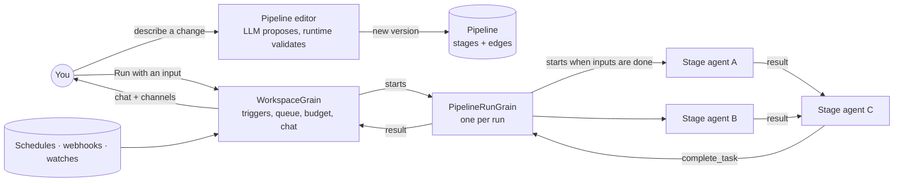

# Workspaces

A workspace is a reusable agent pipeline. You build it on a blank canvas, or describe the job once
("research a market I name and write a fact-checked report") and have a pipeline of agents drafted
from it, and you run it as often as you like: by hand with an input, or automatically from a
schedule, a webhook or a watch.
Change any stage in plain language ("add a security reviewer after Backend") or on the canvas;
every change is a new version you can undo.

## Pieces

| Piece | What it is |
|---|---|
| **Pipeline** | A graph of stages, versioned. A new workspace's pipeline can be empty (a blank canvas), but a run needs at least one stage. Stages with no inputs start with the run; a stage starts once all its inputs have finished; stages nothing depends on give the run's result. Limits come from `Pipelines:*` (20 stages, 5 helpers per stage, 3 retries, 240 minutes per run). |
| **Stage** | Usually an agent; or an **action** (one call of a connection's tool, per item if you like) or a **script** (Python or JavaScript in a sandbox), which run without a model; see [workflows.md](workflows.md). An agent stage has a name, role, instructions and tools (from capability words such as `research`, `http`, `shell`). Settings: helpers it may start (`max_helpers`), whether it may message the run's other stages, retries, what happens if it fails (`FailRun` or `Continue`), and an optional cost cap. Every stage can read and write the run's files and use the workspace's connections. |
| **Run** | One execution of the pipeline with an input: a task typed by a person, a schedule's instruction, a webhook's payload, or a watch's matches. A run is an actor (`PipelineRunGrain`) and the root of its agent tree, and it is also a task: `/api/tasks/{run_id}` and the dashboard's task view show its agent graph, files, events, spend and result. |
| **Trigger** | A schedule (`every_minutes` or a 5-field UTC `cron`), a webhook, a watch, a [form](workflows.md#form-triggers) for members of your organization, or a [record change](solutions.md#record-triggers) in a solution's data. Schedules, webhooks, forms and record changes start a run; a watch alerts you, or starts a run with only the newly matching items. Schedules are Orleans reminders, so they survive crashes and restarts. |
| **Conversation** | Run notices and results, watch alerts, approvals and system notices. A message typed in the chat starts a run with it as the input; addressed to an agent of a run in progress, it reaches that agent instead. Results go to connected channels (SMS, Slack, email) by the pipeline's result urgency. |
| **Variables** | Named values every stage can use, set once on the Variables tab: `{{ vars.name }}` in an action's arguments or an agent's instructions, `vars` in a script's data. See [Variables](#variables). |
| **Daily budget** | One token and dollar limit for the whole workspace per UTC day, checked by the runtime before every LLM call of every run. At 80% the chat warns once. When it's used up, the chat says so once, a banner with a **Raise budget** button stays in the header, and agents that need to run are paused until midnight UTC or until the budget is raised. |

## How a run works

1. The workspace checks the pipeline's runs-at-once limit (`max_concurrent_runs`). With no free
   slot, or while the workspace is paused, the run waits in a queue (a run and its task row exist
   from the start, so callers can follow it). Queued runs start on the pipeline as it is then.
2. The run starts every stage whose inputs are done. An agent stage's agent gets its instructions
   as its goal (with `{{ vars.… }}` filled in), plus the run's input, the workspace's variables, the
   summaries and files of its inputs, and who gets its result. An action or script stage gets the
   run's data as JSON (`input`, `stages`, `previous`, `vars`;
   see [workflows.md](workflows.md#data-between-stages)) and runs without a model. Independent
   stages run at the same time.
3. An agent stage finishes with `complete_task`; an action or script when its call or code does.
   Every stage's output is kept as JSON and handed to the stages that take it as input. A stage
   that fails (or an agent that stops without reporting) is retried with a note about what went
   wrong, except an action that may already have written something; after its retries, `FailRun`
   stops the run and skips what's left, while `Continue` lets later stages run, told it failed.
4. When every stage has finished, failed or been skipped, the run's result is its output stages'
   summaries. It's recorded on the run and the task, posted in the chat, and forwarded to
   channels. The run times out after `max_run_minutes`.

Pausing a run (or the workspace) pauses its agents and starts no new stages; resuming carries on.
Cancelling stops every agent of the run and skips its unfinished stages.

## Editing a pipeline

- **In plain language:** "Describe a change" sends the request and the current pipeline to one
  model call (`PipelineDesignPrompt`), which proposes edits: `add_stage` (after a stage, before
  one, or with explicit inputs for a parallel branch), `update_stage`, `remove_stage`, `connect`,
  `disconnect`. The runtime applies and validates them (`PipelineEditor`, `PipelineValidator`): no
  loops, inputs that exist, known capabilities, limits. The canvas previews the result (new stages
  green, changed amber, removed struck through) and nothing changes until you apply it.
- **On the canvas, by hand** (no model involved, so it works the same whatever model you use):
  - **Move** stages by dragging them. Where you put them is kept for the current version without
    making a new one, since runs don't depend on it; **Tidy up** lays them out automatically again.
  - **Connect** stages by dragging from a stage's right dot to another stage: that stage then takes
    its result. A connection that would make a loop is refused.
  - **Remove a connection** with the × beside its +, or select it and press Delete.
  - **Add an agent** by dragging **New agent** onto the canvas (or clicking it), or by dragging from
    a stage's right dot to empty space: the new agent goes where you let go, taking that stage's
    result.
  - + on a connection inserts a stage there, + at an entry or output stage adds one at that end,
    × (or Delete) removes a stage (its inputs are joined to what it fed), and clicking a stage
    edits its settings, including which model it runs on.
- **Mentions:** in the text boxes (describe a change, stage instructions, a run's input, the chat,
  triggers, a new workspace's description, and the task composer), type `@` to pick an agent, a
  model, a provider or a skill. See [Mentions](#mentions).
- **Versions:** every applied change is a new version; an edit based on an older version is
  refused as a conflict. **History** restores any kept version (as a new version).
- **From a template:** see [templates.md](templates.md) for nine real-world pipelines to start from.
- **A new workspace starts on a blank canvas** (the default on the New workspace form): build the
  pipeline yourself from the palette. A pipeline with no stages is saved but can't run until it
  has one ("The pipeline has no stages yet"); removing the last stage gives the blank canvas back.
  The description is optional then; when given, agents are told it as the workspace's purpose.
- **Or describe it** (*Describe it* on the form): the pipeline is drafted from the description by
  the same editor. If the model can't propose a valid pipeline, the workspace starts with one stage
  that does its purpose. The editor never leaves a pipeline with no stages; only a person can.

## Mentions

Typing `@` in a text box suggests what you can refer to; ↑/↓ and Enter or Tab pick one:

| Mention | Example | Means |
|---|---|---|
| An agent (a pipeline stage), by its id | `@diagnose` | That stage |
| A model, by its profile id | `@claude-fast`, `@default-model` (the server's own) | That model (Settings → Models). A model's id follows its name: renaming it renames the id, mentions included ([llm-settings.md](llm-settings.md)) |
| A provider | `@anthropic` | The organization's models from that provider |
| A skill | `@skill:incident-postmortems` | That skill ([skills.md](skills.md)): the workspace's own, else the organization's |
| Knowledge | `@knowledge:refund-policy.docx`, `@knowledge:on-call-rota` | That document or fact ([memory.md](memory.md)): the workspace's own, else the organization's |

A mention means one thing to whichever model reads it: the runtime adds a short glossary to the
text it passes on (`Mentions`), so a weaker model doesn't have to guess.
- **Describe a change:** "use `@claude-fast` for `@triage`" runs that stage on that model. The
  editor is told every model a stage can run on, and a model that isn't set up is refused.
- **A run's input, stage instructions, the chat and triggers:** each stage's agent is told which
  stage a mention is. A stage whose instructions (or the run's input) name a skill is told to load
  it before anything else, and the canvas shows the skill on the stage. A stage whose instructions
  (or the run's input) name knowledge is told to read it first with `read_knowledge`, which returns
  the whole document (its passages in order) or the fact.
- **Describe a change:** the editor is told the skills too, so "have `@write` follow
  `@skill:report-style`" puts the skill in that stage's instructions.
- **The task composer:** mentioning a model picks it for the task; mentioning a provider picks its
  first model if none is picked yet; mentioning a skill makes the task's first agent load it first.

Unknown handles are left as they are, and an email address is never read as a mention.

## Inside a stage

Stages are autonomous within their limits:
- they use their tools and the workspace's connections, under the workspace's safety policy;
- with `max_helpers` above 0, they can start helpers for big parallel parts, through
  `plan_request`: the model lists the parts, and a fixed rule (`WorkPlanner`) decides whether
  splitting pays off and how many helpers it needs, never more than the stage allows;
- with `may_message_stages`, they can ask a stage working at the same time a quick question
  (`find_agents`, `send_message`).

**Runtime rules (enforced whatever the model says):**

| Rule | Effect |
|---|---|
| `spawn_agent` requires `why_not_myself` | A spawn without a stated reason is rejected. The reason appears in the `AgentSpawnRequested` and `AgentSpawned` events. |
| Helpers come from a plan | A spawn with no plan, or beyond it, is rejected. The plan's helper count is capped by the stage's `max_helpers`. |
| Helpers can't spawn | Helpers get no `spawn_agent` tool and a `MaxChildren` of 0. |
| The spawn result states the cost | For example: "This helper may spend up to 150,000 tokens / $0.75, paid from the workspace's shared daily budget (412,000 tokens / $1.64 left today)." |
| A stage that stops without reporting fails | Nothing else would ever wake it, so waiting would stall the run. |

## Variables

A workspace's **Variables** tab holds named values every stage can use, so a setting like who to
email lives in one place instead of in each stage's instructions:

| Stage | How it uses `email_recipient` |
|---|---|
| Action | `{{ vars.email_recipient }}` in its arguments, like any other expression |
| Script | `data["vars"]["email_recipient"]` (Python) or `data.vars.email_recipient` (JavaScript) |
| Agent | `{{ vars.email_recipient }}` in its instructions is filled in, and every variable is listed in its context |

- Names are lowercase letters, digits and `_`, starting with a letter (40 at most); up to 50
  variables of up to 4,000 characters each. In an agent's instructions only `{{ vars.… }}` is filled
  in: other `{{ … }}`, and variables that aren't set, stay as written.
- A run takes the values it starts with, so editing a variable doesn't change a run in progress.
- Clones and templates copy the variables. Changes are in the audit log, by name.
- They aren't secrets: agents and run data see them. API keys and passwords go in a connection.

## Running out of budget

An agent doesn't fail when its own budget runs out. `BudgetGuard` checks before every LLM call:

1. **Warning.** Once 75% (`RuntimeLimits:WrapUpAtFraction`) of any budget is spent (tokens, tool
   calls, cost or time), or only a few calls' worth of tokens remain, the agent is told to finish
   and to report a `partial` result if it can't.
2. **Final step.** When only one more call fits, that call offers nothing but `complete_task`, with
   output capped at `RuntimeLimits:FinalStepMaxOutputTokens`. `complete_task` is exempt from the
   tool-call budget, so an agent out of tool calls can still report.
3. **Runtime report.** If the agent doesn't report in that call, or not even one more call fits,
   the runtime completes it as `partial` with its latest notes and the unfinished goal as
   remaining work.

A partial result is handed on like any other, marked partial, so later stages work with what
there is.

## Webhooks

- **Authentication:** the secret in the URL, compared in constant time. A wrong secret and an
  unknown trigger both return `404`, so ids can't be probed.
- **Acknowledgement:** `202 Accepted` once the run is started or queued.
- **Deduplication:** senders retry, so redeliveries are dropped. The delivery id is taken from
  `Idempotency-Key`, `X-Shopify-Webhook-Id`, `X-GitHub-Delivery`, `Webhook-Id`, `X-Request-Id`
  or `X-Delivery-Id`, or failing that the body within the same minute. A duplicate returns
  `200 {"status":"duplicate"}`. The run id is derived from the delivery, so a retried fire after a
  crash can't start a second run.
- **Rate limiting:** deliveries beyond `Workspaces:MaxWebhookEventsPerMinute` per trigger get
  `429` and are counted as dropped.
- **Payload handling:** payloads are truncated to `Workspaces:MaxWebhookPayloadChars` and
  labelled as untrusted external data in the run's input. Bodies over `MaxWebhookBodyBytes` get `413`.
- **Paused or archived workspaces** return `409`.

## Token efficiency

- **No polling loops:** nothing runs between runs; a schedule or webhook starts one.
- **Watches** check a connected service in code, at zero tokens per check, and only alert or start
  a run for newly matching items (see [efficiency.md](efficiency.md)).
- **Stages work alone by default.** Helpers cost a model call per step each, so a stage starts them
  only through a plan, and only up to its limit.
- **Hard caps:** the workspace's daily budget, each stage's cost cap, and the run's time limit.

## Files

Agents save deliverables with `filesystem_write`. Each run has its own folder, so later stages of
the run can read what earlier ones saved, and runs never overwrite each other. The **Files** tab
lists every run's files under `run-<number>/`; download them one at a time or all as a zip. A file
is marked **in progress** while its author is still running, **unfinished** if it failed, and
**final** otherwise.

## The workspace screen

Every section is resizable: drag a divider (or focus it and use the arrow keys; double-click
resets it). Sizes are remembered per browser.

Every section can also be hidden, to give the canvas the room on a smaller screen. The buttons at
the right of the canvas tabs show or hide the workspace list, the header (page title and the
workspace's goal, triggers and budget), the runs and the side panel; **Focus** (or Shift+F) hides
all of them at once, and again brings back what was shown. Hidden sections keep their state, and
the layout is remembered per browser. On a first visit from a screen under 1280 pixels wide, the
list and the side panel start hidden. Pending approvals still show when the header is hidden.

- **Left:** your workspaces.
- **Center top, Live agents:** the team at work. You sit at the top, each
  recent run below you, its stage agents below the run, and their helpers below them, joined by
  dashed lines. For about 20 seconds after something happens, messages between agents animate as
  coloured arrows (task, done, question and answer, started), runs started by you and their
  results flow as arrows to and from you, and speech bubbles show what each agent last said or did
  (planning, saving a file, searching). Agents of runs that finished over 30 minutes ago drop off;
  finished agents of recent runs are hidden behind "+N earlier finished agents". **Running only**
  hides every finished run, and each run's chip (#12) hides or shows that run; the choice is
  remembered per workspace in your browser. The tab counts agents working now.
- **Center top, Pipeline:** the pipeline canvas, with "Describe a change", **History** and **Run
  settings** (time limit, runs at once, result urgency). With a run selected, the canvas shows that
  run: each stage's status, a pulsing marker on stages working now, and its result when clicked.
  Both tabs stay loaded, so switching loses neither an unapplied change nor the live history.
- **Center bottom:** **Run** with an input, and the runs, newest first, with pause, resume and
  cancel for runs in progress and a link to each run's full page.
- **Right:** Agents (of recent runs), Files, Skills & knowledge (the workspace's own skills and
  knowledge files and facts, counted on the tab like files), Variables, Triggers (schedules,
  webhooks, watches), Integrations (each connection with its service's logo), Safety and Events
  (each event with a short coloured label, e.g. *Stage start*, *Run*, *Pipeline*; hover a label
  for the full event type). Clicking an agent, on either canvas or in
  the list, opens its details beside the canvas.
- **Chat:** a button in the bottom-right corner opens the conversation over the page and hides it
  again; whether it's open is remembered. While it's hidden, the button counts new messages since
  you last had it open (pending approvals show in amber when nothing is unread), and a new message
  shows as a short preview beside it. Your own messages never count as new.

## Private workspaces

A workspace is visible either to **everyone in the organization** (the default) or **only to its
owner**, the person who created it. Choose when you create it ("Who can see it"). Later, the owner
can switch it with the pill next to the workspace's name (**Organization** / **Only you**).

To everyone else, admins included, a private workspace looks exactly like one that doesn't exist:

- it isn't in the Workspaces list, and its pages and API answer 404;
- its runs aren't in the run history, and its agents, events (live and past), approvals and analytics
  are left out;
- its forms, files, knowledge, skills and MCP gateway are reachable only by the owner;
- its runs can't be replayed, because a replay is an ordinary task that everyone would see.

Other rules:

- **The owner has an admin's say over a private workspace**, even with the Member role: budget,
  connections, safety policy, archiving and deleting. Nobody else can see it to do that for them.
- **Only the owner can change visibility.** An admin can't make someone else's workspace private or
  shared.
- **API keys act for the person who created them.** A private workspace's owner can reach it with
  their own keys.
- **Copies keep their visibility:** cloning a private workspace makes a private copy.
- **Nothing about how it runs changes.** Triggers, agents, budgets and channels work the same; only
  who sees it differs.

If the owner leaves the organization, nobody can see their private workspaces any more. Make a
workspace visible to the organization before handing it over.

## Cloning, templates and deleting

- **Clone** (header) makes a new workspace with this one's setup, ready to run: goal, pipeline and
  stage settings, variables, triggers (webhooks get new secret URLs), safety policy, daily budget, and the
  workspace's own skills and knowledge (unless turned off). Integrations are copied with their
  secrets for Admins: the secrets are copied inside the server and never sent to the browser.
  Adding integrations needs the Admin role, so for anyone else they're listed for an Admin to add.
  A tool switched off on an integration stays off in the copy. **Runs, their results, files, chat
  and approvals are never copied.**
- **Save as template** saves the setup as one of the organization's templates
  ([templates.md](templates.md)), variables included: no secrets, knowledge, runs or files.
- **Delete** (Admins, archived workspaces only) removes the workspace with its integrations and
  their secrets, triggers, skills, knowledge and its own files. Its runs' history (with their files)
  and the audit log are kept as the record of what happened. A study's workspace is deleted with
  its study.

## Workspaces made before pipelines

Earlier workspaces ran on a coordinator agent and standing agents. On first use they are converted:
they get a one-stage pipeline that does their purpose, their schedules and webhooks start runs of
it, and the old agents are retired. Their chat, files, connections, safety policy and budget stay.

## API

| Method | Path | |
|---|---|---|
| `POST` | `/api/workspaces` | `{name, goal, daily_token_limit?, daily_cost_limit_usd?, pipeline?, blank?, visibility?}`; without `pipeline`, one is drafted from `goal`. `blank: true` starts with an empty canvas (then `goal` is optional). `visibility`: `Organization` (default) or `Private` |
| `PUT` | `/api/workspaces/{id}/visibility` | `{visibility}`: owner only (403 otherwise). See [private workspaces](#private-workspaces) |
| `GET` | `/api/workspaces` | List |
| `GET` | `/api/workspaces/{id}` | Snapshot: pipeline, runs, conversation, agents of recent runs (each run's own entry first), triggers, budget |
| `GET` | `/api/workspaces/{id}/pipeline` | The pipeline |
| `PUT` | `/api/workspaces/{id}/pipeline` | `{pipeline, base_version, note?}`: replace it (409 if it changed since `base_version`) |
| `POST` | `/api/workspaces/{id}/pipeline/propose` | `{request}`: the editor's proposal (`ops`, `summary`, `changes`, `errors`, `preview`); changes nothing |
| `POST` | `/api/workspaces/{id}/pipeline/edits` | `{ops, base_version, note?}`: apply edits |
| `PUT` | `/api/workspaces/{id}/pipeline/layout` | `{layout: {stage_id: {x, y}}}`: where stages sit on the canvas, kept on the current version (no new version); `{}` lays it out automatically. An `add_stage` edit can carry a `position` too |
| `GET` | `/api/workspaces/{id}/pipeline/history` | Earlier versions, newest first |
| `POST` | `/api/workspaces/{id}/pipeline/restore` | `{version}` |
| `POST` | `/api/workspaces/{id}/runs` | `{input, data?}`: start (or queue) a run; follow it at `/api/tasks/{run_id}`. Action and script stages see `data` (any JSON) as `input` |
| `GET` | `/api/workspaces/{id}/runs` | Recent runs |
| `GET` | `/api/workspaces/{id}/runs/{runId}` | A run with each stage's kind, status, attempts, result, `output_json`, `logs` and agent, and the run's `input_data` |
| `POST` | `/api/workspaces/{id}/runs/{runId}/pause` \| `resume` \| `cancel` | |
| `POST` | `/api/workspaces/{id}/messages` | `{text, to_agent_id?, client_message_id?}`: starts a run (or reaches an agent of a run in progress); retries with the same `client_message_id` act once |
| `GET` / `POST` | `/api/workspaces/{id}/triggers` | `{kind: schedule\|webhook\|watch\|form\|record, name, instruction, every_minutes?, cron?}`, plus for a watch `source_tool, items_path, conditions, key_field, display_fields, mode (notify\|run), message, urgency`, for a form `form: {title, description, fields, submit_label, success_message}`, and for a record trigger `entity, on: [created\|updated\|deleted], rule?` (solution workspaces); a created webhook's response includes its secret `webhook_path`, a watch's a `dry_run` |
| `GET` | `/api/workspaces/{id}/forms/{triggerId}` | A form trigger's form, for its page (members of the organization) |
| `POST` | `/api/workspaces/{id}/forms/{triggerId}/submissions` | Member; `{answers, submission_id}`: checked per field (`field_errors` on 400), then a run starts. API keys get 403 |
| `POST` | `/api/workspaces/{id}/scripts/test` | Member; `{language, code, data, timeout_seconds?}`: run a script stage's code in the sandbox: `{ok, output, error, logs, duration_ms}` |
| `DELETE` | `/api/workspaces/{id}/triggers/{triggerId}` | |
| `PUT` | `/api/workspaces/{id}/budget` | `{daily_token_limit?, daily_cost_limit_usd?}` |
| `PUT` | `/api/workspaces/{id}/variables` | `{variables: {name: value}}` replaces them all; `400` with the problems when a name or value isn't allowed |
| `POST` | `/api/workspaces/{id}/pause` \| `resume` \| `archive` | |
| `POST` | `/api/workspaces/{id}/clone` | `{name, copy_skills_and_knowledge}`: the setup, not the activity. Reports each integration and trigger, and the new webhook URLs. |
| `POST` | `/api/workspaces/{id}/export-template` | `{name, description, category}`: an organization template. |
| `DELETE` | `/api/workspaces/{id}` | Admin; archived workspaces only. |
| `GET` | `/api/workspaces/{id}/files` | Every run's files (under `run-<number>/`), one entry per file, newest first |
| `GET` | `/api/workspaces/{id}/files/{artifactId}/content` | Download one file |
| `GET` | `/api/workspaces/{id}/files.zip` | Every file as one zip, keeping folders |
| `POST` | `/api/hooks/{workspaceId}/{triggerId}/{secret}` | Inbound webhook (public) |

MCP's `run_goal` and A2A take a `workspace`: the goal becomes the input of a run, and the run's id is
the task id they report. The live event stream is `/ws/events?taskId={workspaceId}` (pipeline
changes, run progress, and its runs' agents' events) or `?taskId={runId}` (one run's agents).
`/api/events?taskId={workspaceId}` includes the five most recent runs' events.

## Tests

`PipelineEditorTests` (unit) covers the rules and edits: adding before, after and in parallel,
removing with the neighbours joined up, loops and limits refused, and canvas positions kept for
existing stages only. `MentionTests` covers finding and explaining mentions, and that the editor is
told the models. `PipelineCanvasApiTests` edits by hand through the API: moving (no new version),
dropping an agent where it was dropped, drawing and removing connections, a loop refused, an
unknown model refused, and "use @default-model for @write" setting that stage's model. `PipelineTests` checks, with a
scripted LLM:
- stages run in order, each with its inputs' results, and the output is the run's result;
- parallel branches run at the same time and the stage merging them waits for both;
- a failing stage is retried, then fails the run and later stages are skipped, or with
  `Continue` later stages run, told it failed;
- webhooks start one run per delivery: the wrong secret is rejected, a redelivery is deduplicated,
  a burst is rate-limited, and the secret never appears in anything an agent sees;
- a schedule runs the pipeline and keeps firing after the silo is killed;
- the daily budget stops LLM calls and posts one notice;
- runs beyond the limit queue, pause holds them, resume starts them;
- a chat message starts one run even when the client retries;
- edits make new versions, stale and invalid edits are refused, and a version can be restored.

`SpawnDisciplineTests` checks a stage's helpers: no more than allowed, a reason and a plan needed,
helpers can't spawn, a finished helper can't be messaged, and a stage without helpers isn't
offered spawning. `WorkPlannerTests` covers the split, delegate and self rule. `BudgetWrapUpTests`
checks the wrap-up above. `ArtifactFilesTests` checks file listing and zips. `CronScheduleTests`
covers cron parsing.
