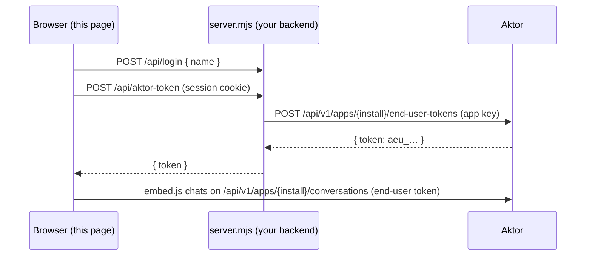

# Assistant test app

A pretend customer site for trying a solution's assistant locally, the way your own product would
use it:

- **Sign-in:** visitors sign in here with any name, no password. Each name is a separate end user.
- **Tokens:** this site's backend (`server.mjs`) swaps the sign-in for an Aktor **end-user token**
  using the solution's **app key**. The key stays on the server.
- **The assistant:** the page embeds it with Aktor's widget (`/embed.js`), in the page or as a chat
  bubble.
- **Your records:** a panel shows the signed-in user's own records (for example the tickets the
  assistant logged for them), read with their end-user token.
- **Integration check:** a panel checks the app key and the assistant, and whether this site's
  origin is allowed.

No dependencies: Node 18 or later.

## Run it

1. **Install a solution with an assistant**, for example `samples/solutions/property-mgmt` (in the
   dashboard: Solutions → Templates → Property management, or `aktor deploy samples/solutions/property-mgmt`).
2. **Allow this site.** The page runs on `http://localhost:4000`, so in the builder set
   **Assistant → Allowed sites** to `*` (any site, for testing) or `http://localhost:4000`, then
   deploy. With an empty list any site is allowed too.
3. **Create an app key** on the solution's **Integrate** tab. Copy it and the install id (`sol-…`).
4. Configure and start:

   ```bash
   cd samples/assistant-test-app
   cp .env.example .env      # set AKTOR_INSTALL_ID and AKTOR_APP_KEY
   node server.mjs
   ```

5. Open http://localhost:4000, sign in as anyone and chat. Sign in under another name to check
   that users don't see each other's conversations or records.

Every conversation also shows in the Aktor dashboard as a task of your organization.

## How it fits together



## Troubleshooting

| What you see | Why |
| --- | --- |
| "Couldn't load …/embed.js" | Aktor isn't running at `AKTOR_URL`. |
| "This app key isn't valid…" | Wrong key or install id, or the key was revoked. |
| Chat says "This app can't be used from this site." | `http://localhost:4000` isn't in the assistant's allowed sites. |
| "This solution has no assistant." | Add one in the builder (Assistant section) and deploy. |
